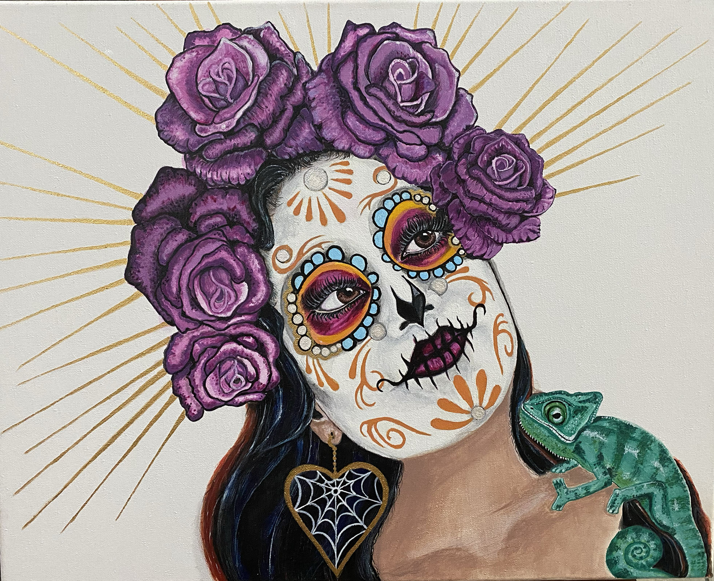

# 👋 Hi, I'm Gloria Garcia!

I'm a Graphic Information Technology student at Arizona State University with a focus on Full-Stack Web Development. I enjoy creating websites and digital experiences that bring together coding, functionality, and visual design.

My GitHub profile is a place to share my programming coursework, web projects, and progress as I continue developing my technical skills.

---

## 🌿 About Me

I'm a self-taught artist and a student who enjoys both the creative and technical sides of technology. My background includes graphic design, web development, and hands-on experience helping people use technology.

I am interested in front-end development, JavaScript, databases, and data analytics. I enjoy working through problems, learning new tools, and building projects that are useful as well as visually organized.

After graduation, I hope to work in a technology-focused position where I can continue growing as a developer and use my design and analytical skills. I want my portfolio to show how I approach projects from both a design and coding perspective.

---

## 💻 Technical Skills

### 🌐 Web / Programming

### 🛠️ Tools

### 🎨 Design

### 📊 Additional Experience

Data analysis and visualization through ASU's Data Analytics Global Career Accelerator.

---

## 🎓 Education

**🏫 Arizona State University**
- Graphic Information Technology, with a focus on Full-Stack Web Development.

Coursework and projects have involved web development, JavaScript, accessibility, UX/UI design, and project management.

**📚 Associate of Arts in Mathematics and Sciences.**

---

## 🏅 Certifications / Additional Training

**📊 ASU Data Analytics Global Career Accelerator**

Completed training with practical experience in data analysis, SQL, visualization, and an Intel sustainability project.

**💊 Certified Pharmacy Technician**

Prior professional certification and training.

---

## 🚀 Current Projects

### 🎨 Gloria Garcia Studio

A single-page interactive art portfolio featuring original paintings and digital artwork.

### 💻 Work in Progress

Currently developing projects that combine web development, UX/UI, and graphic design.

---

## 🖼️ Featured Artwork

---

## 🔗 Find My Work

---

## 🌙 Outside of Coding

I enjoy painting, digital illustration, screen printing, photography, anime, nature, and creating artwork inspired by Chicano and Mexican culture.
